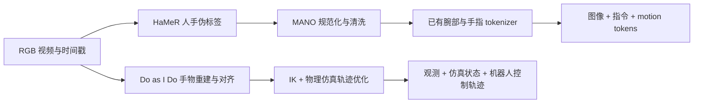

# Being-H0 与 Do as I Do：RGB 视频到训练数据的复现计划

**日期：** 2026-10-24  
**状态：** 规划稿；尚未实施。  
**目标约束：** 本地改代码 → Git 同步 → 5880 Ada 48GB 服务器执行，最多 8 卡。使用已有模型做数据提取，不训练模型、不做实机。  
**调研依据：** [官方代码与论文核查](research-rgb-data-pipelines.md)。

## 1. 最终要得到什么

交付两条能处理指定 RGB 视频、保留中间结果、支持重跑的数据流水线，以及一批可审阅的数据样本。



| 路线 | 核心监督 | 交付终点 |
|---|---|---|
| Being-H0 | 人手运动，不是机器人控制指令 | 图像、语言、连续 MANO、离散 motion tokens、指令 JSONL |
| Do as I Do | 特定机器人具身下的仿真轨迹 | 手物重建、场景模型、机器人状态与控制、时间对齐、样本索引 |

首批同时处理 5–10 段 3–10 秒、静态相机、手物清晰可见的单刚体操作视频。优先选单手拾取/放置、搅拌一类容易审阅的操作；随后再纳入双手、遮挡和运动相机。这样选是便于定位首轮问题，不代表两篇论文都只支持这些输入。

不下载 Being-H0 的 1B/8B/14B VLA 主干来生成伪动作。RGB 数据处理需要的是手姿估计器和已训练的动作 tokenizer；用 VLA 生成动作并不能替代视频中的人手动作测量。

## 2. 当前状态与范围

现有仓库是学习资料与文献集合，入口见 `README.md:5`。已核对两个上游版本，尚未导入处理工程。用户现有的笔记修改应保留。

本轮覆盖两种路线的端到端数据生成、可视化和质量检查。包括 Do as I Do 的仿真优化；如果只停在三维网格，会缺少其机器人数据生成的关键步骤。

本轮不做 tokenizer/VLA/手姿估计器训练，不做大规模 UniHand 全量重建，不接实机，不以训练 loss 或机器人任务成功率作为验收。论文原始清洗阈值未公开的部分，需要记录为“本项目补齐规则”；不将其表述成作者原代码。

## 3. 本地与服务器的工作分工

| 位置 | 工作 |
|---|---|
| 当前电脑/当前仓库 | 阅读与修改 wrapper、配置、导出器、质量规则；检查 schema、路径、时间对齐等轻量逻辑；审阅小样本可视化 |
| Git | 保存本项目源码、配置、上游版本清单、补丁、格式说明、小型统计与实验记录 |
| GPU 服务器 | 安装独立环境；下载模型；存放视频；运行估计、跟踪、分词、重定向；保存大体积中间产物 |

建议采用“本项目代码 + 固定上游源码 + 补丁”的组织方式。上游下载目录忽略，不把普通嵌套 Git 仓库直接加入主仓库。对上游的修改必须形成主仓库中的补丁并由初始化脚本重放；只在上游目录改完却只 push 主仓库，会丢失修改。

拟新增结构如下，**本次只创建本计划与调研文档，以下目录和脚本在实施时建立**：

```text
data_pipelines/               本项目的编排、格式适配、质检、导出
configs/data_pipelines/       非敏感配置、质量规则、上游版本清单
scripts/data_pipelines/       上游初始化、环境探测、单样本和批处理入口
patches/                     对固定上游提交的可重放修改
tests/data_pipelines/         时间轴、坐标变换、token、导出的必要测试
external/                    自动下载的固定上游源码，Git 忽略
docs/rse/specs/               计划、实验记录与格式说明
```

服务器数据根目录通过 `REPRO_DATA_ROOT` 配置；原视频、模型、NPZ、网格、逐帧图像与完整日志放在数据根目录，不随 Git 传输。路径使用配置传入，不写死当前电脑或服务器用户名。MANO 和 gated 模型由用户账号获取，令牌留在服务器认证配置，不进入 Git。

## 4. 执行顺序与阶段验收

### 阶段 A：准备环境与最小输入（约 1–2 个工作日）

依赖：可访问服务器；MANO、SAM 3、SAM 3D 权限可用。没有服务器访问时，可先完成本地代码组织与输入格式。

1. 固定 Being-H0 为 `ae92e46f671f48d91161ef1c8cc956bcdffab606`、Do as I Do 为 `824591b808c342b20079c3b4198a8c2bdf88c74e`；HaMeR 在实际初始化时记录检出的提交和所有子模块版本。保留 Do as I Do 官方 fork 的子模块版本。
2. 建立 `configs/data_pipelines/sources.json` 记录源地址、提交与补丁哈希；下载权重时记录 Hugging Face revision 和所需文件哈希。
3. 用 Do as I Do 自带 `whisking` 样例作为环境验收输入；另登记首批视频的原文件 SHA256、时长、原 FPS、分辨率、时间基、左右手和任务说明。切片保留原视频 ID 与起止时间。
4. 服务器先执行下列只读检查，将输出保存为环境记录：

```bash
nvidia-smi --query-gpu=index,name,memory.total,driver_version --format=csv
nvidia-smi topo -m
free -h
df -h
python --version
conda --version
```

5. 按官方要求分别准备 HaMeR、Being-H0 动作 tokenizer、Do as I Do 四个重建环境和重定向环境。允许经过验证后复用环境，但首轮以依赖隔离为默认。

验收：环境记录齐全；每个环境能导入对应模块、识别 GPU 和读取所需模型；所有输入与权重可定位。Do as I Do 重建官方容量要求 ≥32GB，48GB 单卡满足门槛；每阶段仍需测峰值显存。不要照抄官方 Blackwell 示例中的编译架构值，使用服务器实际 GPU 架构。

### 阶段 B：先跑 Do as I Do 官方原生输出（约 2–4 个工作日）

依赖：阶段 A。先验证附带的预处理样例能读取和重定向，再从原视频重跑重建，避免安装故障与重建质量故障混在一起。

涉及上游位置：`reconstruction/run_pipeline.sh:16`、`reconstruction/config/paths.sh:35`、`retargeting/launch.py:34`。具体源码依据见调研文档。

官方入口如下，在对应仓库及环境已安装后执行：

```bash
cd external/do-as-i-do/retargeting
conda activate retargeting
python launch.py --task whisking --raw-dir ../reconstruction/whisking \
  --no-show-viewer --no-wait-on-finish --max-sim-steps 100 --seed 0
```

该命令只用于短程冒烟检查。完整轨迹运行时去掉 `--max-sim-steps 100`。每次运行用独立工作目录/输出目录，保留官方示例，避免覆盖参考产物。

随后在 `reconstruction/` 下重跑官方 RGB 入口：

```bash
./run_pipeline.sh whisking/whisking.mp4 125 whisk right
```

这一步官方默认需要点击分割。首轮可以用远程桌面/X 转发完成并记录提示；要做无人值守批处理时，再封装已有点/文本提示接口，保存提示帧、坐标和对象 ID。不能仅因为服务器能渲染离屏画面，就认为已解决交互式点击。

验收：能解释每个输出来自哪个步骤；手、物体和相机投影可叠加审阅；能够从 RGB 重建结果重新运行重定向；保存 `scene.xml`、IK 轨迹、`trajectory_mjwp.npz` 和解析后的配置。先记录完整样例的耗时、显存与存储量，再扩到自己的视频。

### 阶段 C：复现 Being-H0 的 RGB 伪标签与动作分词（约 3–5 个工作日）

依赖：阶段 A；可与阶段 B 的 GPU 长任务错开进行本地开发。

1. 在 `data_pipelines/being_h0/` 封装 **HaMeR** 视频推理，保存左右手 MANO 参数、原图坐标、相机信息、手检测/关联信息、时间戳及有效帧掩码。首轮静态相机；不将单目估计平移当成具有真值精度的尺度。
2. 实现手侧关联、错配检查、短缺口插值与清洗。只在同一只手的短缺口内插值；长时间遮挡、出画或身份不确定时拒收相应窗口。对旋转使用合理的旋转插值；缺失不写成“静止的零姿态”。所有阈值进入配置并标为本项目规则。
3. 保存连续运动后，构造 checkpoint 规定的腕/指输入，完成单位、参考坐标、旋转表示、根关节处理与特征顺序适配。原生 MANO 参数与编码特征分别保存。
4. 动作按 15 FPS 重采样；构造一秒动作窗口。多秒样本保持同一个参考坐标，避免每秒重置导致手腕跳变。时间不足、插值和 padding 均保存有效掩码。
5. 只加载已有 `Being-H0-GRVQ-8K` 的腕部/手指模型及配置、mean/std、meta mask，执行编码与解码检查。代码入口参考 `mano_adapter.py:225`、`:364`、`:428`。分开保存原始 codebook ID、部位偏移后的 motion ID 与可选的 LLM 词表 ID，不能混用。
6. 验证 token 范围、每块长度、左右手/时间顺序。对同一输入，比较本项目封装与固定上游编码输出；解码后检查关节/网格和原连续轨迹的差异。只有通过往返检查，才批量分词。

验收：至少一段自己的 RGB 视频得到连续 MANO、有效掩码、motion tokens 和解码可视化。输出维度必须与实际 checkpoint 一致；不凭“MANO-D162”名称猜测编码输入。此阶段需要补齐工程，不能宣称已有官方一键制备脚本。

### 阶段 D：生成可消费的训练数据文件（约 2–3 个工作日）

依赖：B/C 的原生输出通过质检；此阶段只导出和读取，不更新模型。

**Being-H0：** 先以人工核验的文本跑通少量样本，随后实现论文的最长 10 秒片段、2 FPS 语言取帧、chunk/单秒/单手/双手描述，以及动作生成、动作翻译、上下文预测三类模板。原文 Gemini 标注属于原方法；若改用本地 VLM或人工文本，记录为标注来源变体。需要调用外部模型时，先确定使用账号、预算和允许上传的视频，再执行。

导出 JSONL，每条包含：`id`、`video_id`、`image`、时间窗口、hand mode、task type、文本/对话、motion token 引用、连续轨迹引用、有效掩码引用、标注来源、质量状态。图像路径相对于数据包根目录。窗口需明确图像时刻与未来动作范围，禁止跨 train/val 视频或越过缺失区间拼接。

**Do as I Do：** 保留官方完整 NPZ 与场景；另导出便于消费的 episode。将规划块/子步展开到明确时间轴，保留 `time`、机器人状态、控制信号、物体状态、关节/actuator 名称与单位、机器人模型哈希、有效掩码和视频时间映射。

预热阶段在训练样本索引中单独标记，默认排除，因为它没有对应的人类视频观测。仿真频率与视频 FPS 分开保存，按时间戳对齐；不能将第 n 个仿真状态直接配第 n 帧视频。也不能将含物体自由关节的整条 `qpos` 当成机器人 action。

原始人类 RGB 配机器人伪动作，属于跨具身监督；如果将来希望得到标准“机器人视角 RGB + 机器人动作”数据，需要另行配置仿真相机并渲染观测，不能把人类画面称为机器人观测。

验收：用一个只读 loader 顺序和随机读取数据包，所有引用存在、形状一致、时间对应明确；可显示“输入帧 + 标签/轨迹 + 文本”组合供人工核验。无需通过实际训练证明文件可读。

### 阶段 E：10 段验收，再扩到 100 段（约 2–3 个工作日）

依赖：前四阶段通过，且单视频成本已测量。

固定一份视频清单，分别记录两条流水线的成功与失败阶段。先验证 10 段中每一段都有明确的接收/拒收结论和可定位原因；不要求所有输入都能生成合格数据，不静默删掉失败片段。人工审阅通过的样本才能进入导出包。

随后按视频独立分配 GPU，一卡一个重任务，从 2 卡试运行再扩到 4/8 卡。Do as I Do 的 `paths.sh` 需要补丁允许外部 GPU 设置；每个任务有独立工作目录、端口和输出目录。重建阶段串行使用同一卡，首轮避免四个模型同时驻留显存。

记录每视频秒处理耗时、各阶段失败率、每视频秒落盘字节数、显存峰值、人工修订时间和最终可用样本数量。用首批中位数与较慢样本估计 100 段成本，再决定规模，不预设精确 GPU 小时数或线性八卡加速。

验收：数据包、质量报告和失败清单完整；换一个干净工作目录，固定版本、配置、输入与种子重跑最小样例并核对结果。浮点/GPU 优化允许预先定义的误差范围；不能只保存日志就称为可复现。

## 5. 数据包格式与质量准则

建议统一外层包装，方法原生结果保持独立：

```text
dataset/
  manifest.jsonl
  episodes/<episode_id>/
    meta.json                   输入哈希、时间基、版本、方法、坐标/尺度约定
    source/                     输入视频或可定位引用
    being_h0/
      mano.npz                  原生连续参数、时间戳、左右手、有效掩码
      motion_tokens.npz         代码及分块/偏移约定
      samples.jsonl             图像/语言/动作样本索引
    do_as_i_do/
      reconstruction/           官方手物重建产物
      retargeting/              官方场景、配置和完整轨迹
      episode.npz               可消费的状态/控制/时间轴与掩码
    qa.json                     自动检查、人工审阅、失败原因
```

这是本项目拟定的数据包装，不能当成两篇论文相同的官方存储格式。两条路线保持独立有效掩码、坐标变换和来源；不要为了共享中间数据，把 HaWoR 输出直接替代 Being-H0 原路线的 HaMeR 输出。

**自动检查：** 时间戳严格单调；数组长度和手侧一致；不存在未标记 NaN/Inf；旋转有效；图像/网格/轨迹引用存在；token ID 在码本范围内；窗口及 padding 掩码正确；导出 action 维度与机器人/actuator 列表匹配；不同视频的输出无覆盖。

**人工检查：** 手侧不颠倒，手指投影合理；遮挡不被虚构成长轨迹；物体不持续漂移或翻转；手物尺度和接触看起来合理；解码运动与输入标签一致；文本描述确实对应视频。

没有真值时，使用覆盖率、时序稳定性、投影一致性和人工标签评审，不报告凭空的真实三维误差。Do as I Do 的仿真跟踪误差应与重建误差分开；轨迹跟踪良好不能证明输入重建正确。

## 6. Git 同步操作约定

本地把本项目代码、配置、上游锁定清单和补丁一起提交并 push。提交前检查 staging，只加入本次文件，避免带入笔记或大数据。服务器工作树保持干净，使用同一分支：

```bash
git pull --ff-only
git rev-parse HEAD
```

随后由初始化脚本恢复固定上游版本并重放补丁，才执行处理任务。记录每次运行的主仓库提交、上游提交、补丁哈希和配置。Git 更新不会同步数据与模型，需要独立缓存和路径配置。

一次数据运行至少保存：输入视频哈希、模型 revision/哈希、环境清单、完整命令、实际解析后的配置、种子、GPU/驱动、开始结束时间、阶段状态、输出清单。已有成功阶段通过输入/配置哈希判断是否可复用；参数变化不能悄悄沿用旧缓存。

## 7. 下一步优先级

1. **先建立工程骨架与版本锁定方式，准备 MANO/SAM 权限和服务器环境信息。**
2. **用 Do as I Do 官方 whisking 样例验证重建与重定向的原生数据闭环。**
3. **补 Being-H0 的 HaMeR 视频适配、MANO 清洗与 tokenizer 编码。**
4. **在同一批自己的视频上导出两类样本，再决定扩规模。**

整体按约 2–3 周的工程安排估算；账号授权、依赖编译、遮挡视频质量会影响进度。第一轮目标是完整解释并审阅每一个产物，不是一次性吞入大量视频。

## 8. 验证与实施边界

本次已经核查论文原文、官方 README、固定提交的编码和输出入口；没有安装服务器环境、下载权重或执行 GPU 数据生成。下一次实施按本计划从阶段 A 开始；具体代码修改前，应针对阶段 C/D 的格式和数值约定完成实现设计与必要的单元测试。

本计划的实现验收重点是数据与元信息，不为简单配置或文档增加形式化测试。坐标变换、旋转插值、token 偏移和时间对齐需要已知输入/恒等变换等有意义的测试。

## 参考

- [调研与固定源码证据](research-rgb-data-pipelines.md)
- [Being-H0 论文](https://arxiv.org/abs/2507.15597)与[官方代码](https://github.com/BeingBeyond/Being-H0)
- [HaMeR 官方代码](https://github.com/geopavlakos/hamer)
- [Do as I Do 官方代码](https://github.com/malik-group/do-as-i-do)与[论文](https://arxiv.org/abs/2606.19333)
